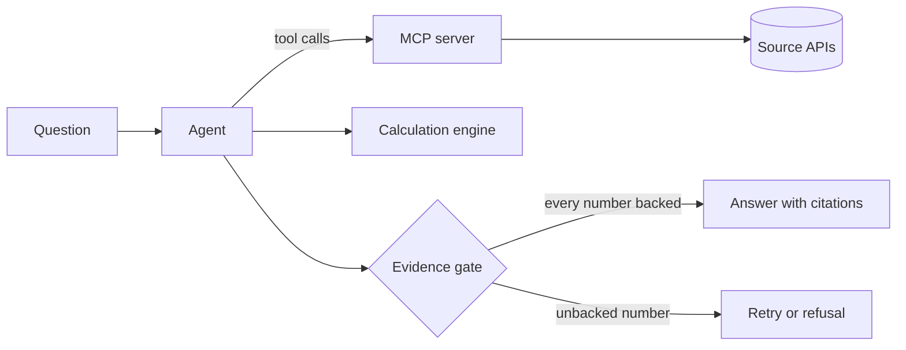

# OpenCited

OpenCited answers questions from authoritative public sources. Every number in an
answer links to the data it came from, calculations run in code where they can be
checked, and the agent refuses to answer when it cannot back a number. The first
source is Statistics Norway (SSB).

> [!NOTE]
> OpenCited is in early development. This repository holds the project foundation
> and the first specification. Nothing is usable yet. See the [roadmap](docs/roadmap.md).

## How it will work

1. You ask a question in Norwegian or English.
2. The agent finds the right tables through the OpenCited MCP server. Every value
   it gets back carries a provenance record: source, licence, table, API request,
   retrieval time and a hash of the raw response.
3. Calculations run as SQL in DuckDB with exact decimals. The language model never
   states a number from its own knowledge.
4. Before an answer is released, an evidence gate matches every number in it to a
   source value or a calculation result. An answer that fails is retried or refused
   with a reason.
5. An open evaluation suite measures how often the answers are right.

The MCP server will also work on its own, so MCP clients such as Claude Code can
query the sources and get provenance with every value.

## Sources

| Source | Publisher | Status |
| --- | --- | --- |
| StatBank | Statistics Norway (SSB) | First source, specification in draft |
| Other national statistics offices | Various | Candidate |
| International statistics | Eurostat, OECD and others | Candidate |
| Health guidance | Approved health authorities | Candidate, risk review first |

Every source passes a review before it is added. See [sources](docs/sources.md).

## Documentation

- [Architecture](docs/architecture.md)
- [Roadmap](docs/roadmap.md)
- [Decision records](docs/adr/README.md)
- [Specifications](docs/specs/README.md)
- [Sources](docs/sources.md)
- [Development](docs/development.md)
- [Contributing](CONTRIBUTING.md) and [security policy](SECURITY.md)

## Licence

The code is licensed under the [Apache License 2.0](LICENSE). Evaluation datasets
will be published under CC BY 4.0. Data from each source keeps its own licence.
Statistics Norway publishes its statistics under CC BY 4.0. Whether that covers data
taken through its API is an open question in [spec 0001](docs/specs/0001-ssb-mcp-server.md).

OpenCited is an independent project. It is not affiliated with or endorsed by
Statistics Norway or any other source it uses.

## Author

Built and maintained by Daniel Norlan ([LinkedIn](https://www.linkedin.com/in/daniel-norlan)).
