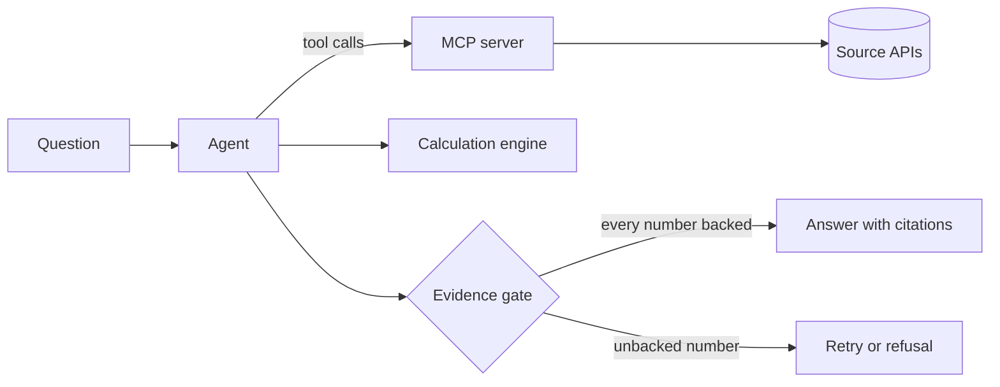

# OpenCited

<!-- mcp-name: io.github.danielnorlan/opencited -->

[](https://github.com/danielnorlan/opencited/actions/workflows/ci.yml)
[](https://github.com/danielnorlan/opencited/blob/main/LICENSE)

OpenCited answers questions from authoritative public sources. Every number in an
answer links to the data it came from, calculations run in code where they can be
checked, and the agent refuses to answer when it cannot back a number. The first
source is Statistics Norway (SSB).

> [!NOTE]
> OpenCited is in early development. The MCP server for StatBank runs from a clone of
> this repository and is not on PyPI yet. The calculation engine, the evidence gate,
> the agent and the evaluation suite are built, and the
> [first published run](https://github.com/danielnorlan/opencited/blob/main/evals/results/README.md)
> of the suite answered 27 of 44 questions correctly with DeepSeek's `deepseek-flash`.
> See the
> [roadmap](https://github.com/danielnorlan/opencited/blob/main/docs/roadmap.md).

## How it will work



1. You ask a question in Norwegian or English.
2. The agent finds the right tables through the OpenCited MCP server. Every value
   it gets back carries a provenance record: source, licence, table, API request,
   retrieval time and a hash of the raw response.
3. Calculations run as typed plans over stored snapshots, with exact arithmetic.
   DuckDB selects the values, and every step is shown. The language
   model never states a number from its own knowledge.
4. Before an answer is released, an evidence gate matches every number in it to a
   source value or a calculation result. An answer that fails is retried or refused
   with a reason.
5. An open evaluation suite measures how often the answers are right.

## The MCP server

The MCP server also works on its own, for MCP clients that start a server over stdio
or connect over Streamable HTTP. It offers three tools, `search_tables`,
`get_table_metadata` and `query_table`, and every query result carries a provenance
record.

The commands below use `uvx opencited mcp`, which works once the package is on PyPI.
Until then, run the server from a clone of this repository with
`uv run --directory /path/to/opencited opencited mcp` in place of
`uvx opencited mcp`.

### Claude Code

```sh
claude mcp add --transport stdio opencited -- uvx opencited mcp
```

Over Streamable HTTP, start the server with `uvx opencited mcp --http`, which listens
on `127.0.0.1` only, and add it with:

```sh
claude mcp add --transport http opencited http://127.0.0.1:8765/mcp
```

### VS Code and other clients that read `.mcp.json`

Put this in `.mcp.json` at the root of a project. Claude Code reads the same file for
servers that a project shares.

```json
{
  "mcpServers": {
    "opencited": {
      "type": "stdio",
      "command": "uvx",
      "args": ["opencited", "mcp"]
    }
  }
}
```

### Options

`opencited mcp --help` lists the options. `--http` serves Streamable HTTP, on port
8765 unless `--port` sets another. SSB's metadata and data responses are cached in
the user's cache directory until the next 08:15 Norwegian time; `--cache-dir` moves
the cache and `--no-cache` turns it off. `--snapshot-dir` keeps a snapshot of each
query result, which the server never changes once written; a result with a value
wider than 38 digits gets none. From 05:00 to 08:15 Norwegian time, `query_table`
returns an error instead of data, since SSB revises figures then.

## Asking a question

`opencited ask` answers a question with a language model of your choice, through an
endpoint that is compatible with the OpenAI chat completions API, such as a hosted
provider or a local server. Three variables name the endpoint, the model and the
variable that holds the API key:

```sh
export OPENCITED_MODEL_URL=https://api.example.org/v1
export OPENCITED_MODEL=model-name
export OPENCITED_MODEL_KEY_VARIABLE=EXAMPLE_API_KEY
opencited ask "Hvor mange bor i Norge?"
```

The answer comes in the language of the question, or in the one `--language no` or
`--language en` sets, with numbered sources. `--json` prints every record: the
citations with their provenance records and the cells used, the calculations with
their SQL, the gate report, the model and its settings, and the usage. The command
exits with 0 for an answer, 3 for a refusal, 1 when the run fails and 2 when the
configuration cannot be used.

Each question is limited to 12 model calls, 20 tool calls, 100,000 tokens and 300
seconds. The [architecture page](https://github.com/danielnorlan/opencited/blob/main/docs/architecture.md#agent-m2)
lists the variables that change these limits and set prices, a temperature, a seed
and extra request fields, such as the one that turns off a model's thinking mode.

## Sources

| Source | Publisher | Status |
| --- | --- | --- |
| StatBank | Statistics Norway (SSB) | First source, in progress (M1) |
| Other national statistics offices | Various | Candidate |
| International statistics | Eurostat, OECD and others | Candidate |
| Health guidance | Approved health authorities | Candidate, risk review first |

Every source passes a review before it is added. See [sources](https://github.com/danielnorlan/opencited/blob/main/docs/sources.md).

## Documentation

- [Architecture](https://github.com/danielnorlan/opencited/blob/main/docs/architecture.md)
- [Roadmap](https://github.com/danielnorlan/opencited/blob/main/docs/roadmap.md)
- [Decision records](https://github.com/danielnorlan/opencited/blob/main/docs/adr/README.md)
- [Specifications](https://github.com/danielnorlan/opencited/blob/main/docs/specs/README.md)
- [Sources](https://github.com/danielnorlan/opencited/blob/main/docs/sources.md)
- [Development](https://github.com/danielnorlan/opencited/blob/main/docs/development.md) and [releasing](https://github.com/danielnorlan/opencited/blob/main/docs/releasing.md)
- [Contributing](https://github.com/danielnorlan/opencited/blob/main/CONTRIBUTING.md) and [security policy](https://github.com/danielnorlan/opencited/blob/main/SECURITY.md)

## Licence

The code is licensed under the [Apache License 2.0](https://github.com/danielnorlan/opencited/blob/main/LICENSE). Evaluation datasets
will be published under CC BY 4.0. Data from each source keeps its own licence.

Data from StatBank comes from Statistics Norway (SSB) and is licensed under
[CC BY 4.0](https://creativecommons.org/licenses/by/4.0/), as SSB's
[API guide](https://www.ssb.no/en/api/pxwebapiv2) states.

OpenCited is an independent project. It is not affiliated with or endorsed by
Statistics Norway or any other source it uses.

## Author

Built and maintained by Daniel Norlan ([LinkedIn](https://www.linkedin.com/in/daniel-norlan)).
