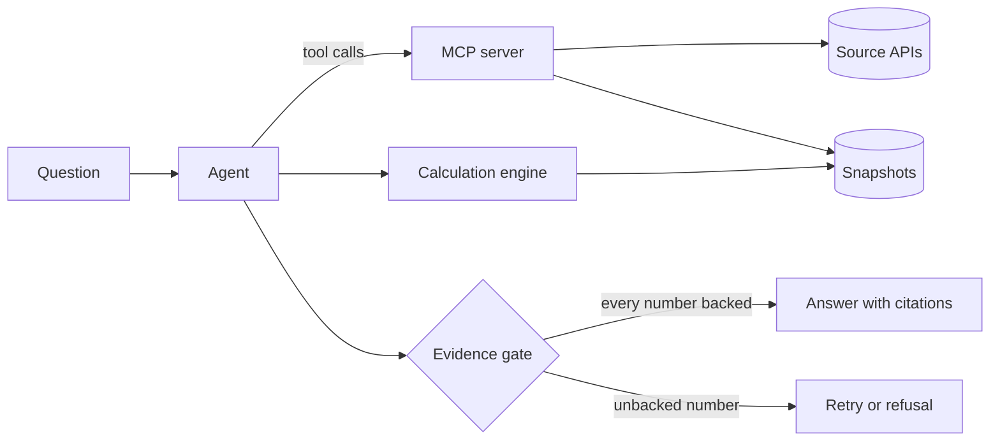

# Architecture

This page describes the target design. The status column shows what exists today,
and everything else on the page is planned. The reasons behind the choices are in the
[decision records](adr/README.md).

## Components

| Component | Responsibility | Status |
| --- | --- | --- |
| MCP server | Table search, metadata and data from each source, with a provenance record on every data result | In progress ([spec 0001](specs/0001-ssb-mcp-server.md)) |
| Calculation engine | Runs typed calculation plans over stored snapshots: DuckDB selects the cells, and the arithmetic uses exact rational numbers | Specification approved ([spec 0002](specs/0002-snapshots-and-calculation.md)) |
| Evidence gate | Matches every number in an answer to source data or a calculation result, and blocks the answer otherwise | Specification approved ([spec 0003](specs/0003-evidence-gate.md)) |
| Agent | Plans, calls tools and drafts the answer, in a loop of its own over a chat completions API | Specification approved ([spec 0004](specs/0004-agent.md)) |
| Evaluation suite | Versioned questions with computed answers, run with Inspect AI | Specification approved ([spec 0005](specs/0005-evaluation-suite.md)) |
| Table search | Hybrid full-text and vector search over table metadata, in PostgreSQL with pgvector | Planned, M3 |
| Model gateway | Routes requests between local and hosted models within budgets, using LiteLLM | Planned, M3 |
| Tracing | OpenTelemetry traces, viewed in Langfuse | Planned, M3 |

## Package layout

One Python package, `opencited`, with one subpackage per layer. A module imports only
from the modules above it in the table, so the source clients and the snapshots
stay free of the server, the agent and the evaluations. `ProvenanceRecord` lives in
`opencited.provenance` and `QueryResult` in `opencited.sources`. The Inspect task
lives outside the package, in `evals/`.

| Module | Contents | Milestone |
| --- | --- | --- |
| `opencited.values` | Decimal parsing, the decimal type that JSON writes in fixed point and never reads from a float (M1), and formatting in Norwegian and English (M2) | M1 |
| `opencited.model` | The strict, frozen base of every model, and the field types they share | M1 |
| `opencited.http` | The HTTP client, the rate limiter and the response cache | M1 |
| `opencited.provenance` | The provenance record, built from the exchange that a result came from | M1 |
| `opencited.sources` | The interface every source implements, and the registry of sources | M1 |
| `opencited.sources.pxweb` | PxWebApi 2 selections: codes and expressions expanded on the metadata, and cell counts | M1 |
| `opencited.sources.ssb` | The StatBank client: search, metadata, data, queries with provenance, and JSON-stat parsing | M1 |
| `opencited.snapshots` | Write-once snapshots of raw responses, with the parsed values in Parquet | M2 |
| `opencited.mcp` | The MCP server and its three tools | M1 |
| `opencited.cli` | The command line: `opencited mcp` | M1 |
| `opencited.calc` | Typed calculation plans, the SQL they generate and exact rational arithmetic | M2 |
| `opencited.gate` | Number extraction from answer text and matching against values and results | M2 |
| `opencited.agent` | The loop that calls the model and the tools, checks answers and retries | M2 |
| `opencited.evals` | The deterministic scorer and the runner for reference plans | M2 |

## Source layer and MCP server (M1)

### Requests

A tool call becomes at most two requests to the source API: a metadata request,
usually served from the cache, and a data request.

1. The tool validates its input against the schema the server publishes. A table ID
   must have five digits. A malformed input fails before any request is sent.
2. For `query_table`, the client reads the table metadata, expands the selection to
   the value codes it covers and counts the cells. A selection above the limit fails
   before the data request.
3. The client sends the data request as GET when the URL fits within a conservative
   length, and as POST otherwise ([ADR 0007](adr/0007-ssb-pxwebapi-v2.md)).
4. The raw response body is kept as bytes. Its SHA-256 is computed from those bytes,
   and the values are parsed from the same bytes.
5. The result carries the values, the symbols and notes for missing values, and one
   provenance record.

### Data model

| Type | Fields |
| --- | --- |
| `TableSummary` | ID, title, first and last period, last update, link |
| `TableMetadata` | ID, title, units, dimensions with codes and labels, notes, last update, link |
| `Dimension` | Code, label, values in source order, whether it is the time dimension, whether it may be left out |
| `Observation` | One value code per dimension, the value as a decimal or none, and the symbol when the value is missing |
| `QueryResult` | Table ID, dimension order, observations, notes, symbol explanations, provenance, and whether it came from the cache |
| `ProvenanceRecord` | The fields in spec 0001: source, publisher, licence, table, request, retrieval time and response hash |

Values are `Decimal` inside the package and decimal strings at the MCP boundary
([ADR 0009](adr/0009-exact-decimals.md)). Every type is a frozen Pydantic model in
strict mode, so the output schema of each tool comes from the same model that the
code uses.

### Errors

| Situation | Error | Seen by the client as |
| --- | --- | --- |
| Invalid table ID, unknown dimension or value code | Validation error with the allowed values | Tool error, so the model can correct the call |
| Selection above the cell limit | Error with the cell count and how to narrow the selection | Tool error |
| Source unavailable, timeout or HTTP 5xx | Error that names the source and says nothing was returned | Tool error |
| Rate limit reached | The client waits up to 10 seconds for a free slot, then reports when the next one is free | Tool error |
| Data requested from 05:00 to 08:15 Norwegian time | Error that names SSB's revision period | Tool error |
| An answer from SSB that breaks the expected form | Error that names the value that does not fit | Tool error |
| Any other failure inside the server | Logged on the server, without its text sent on | Tool error with no detail |
| Malformed protocol request | Handled by the MCP SDK | Protocol error |

### Caching and rate limits

Metadata and data responses are cached in SQLite, keyed by the method, the URL and a
hash of the body ([ADR 0008](adr/0008-http-client.md)). An entry stores the response
as it arrived, with its retrieval time, so a cached result repeats the original
provenance, and a query result says whether its data came from the cache. A response
is stored only once the result built from it has been accepted, so an answer that
cannot be parsed, or a reply with other cells than the selection, is never served
again. An entry is served until the first 08:15 Norwegian time after its request,
when the figures published at 08:00 are final. A data response requested or received
from 05:00 to 08:15 is not stored, and search results and `/config` are not cached.
When SSB cannot be reached, a call fails with an error and never falls back to an
expired entry.

`opencited mcp` keeps the cache in `responses.sqlite` in the user's cache directory,
which `platformdirs` finds for each system, for example `~/.cache/opencited` on
Linux. `--cache-dir` moves it and `--no-cache` turns it off. The bodies can name the
staff behind a table, so on systems with POSIX permissions the file is readable by
its owner only, and so is a directory that the cache creates. A cache that cannot be
read or written is skipped with a warning.

Every request to SSB waits for a slot in a client-side rate limiter: at most 30 in
any 60 seconds, the limit in SSB's guide ([ADR 0007](adr/0007-ssb-pxwebapi-v2.md),
decision 3). The limiter also keeps the policy that a response's
`x-ratelimit-policy` header states, and a request goes out only when every policy
allows it, so a header can only make the limiter stricter. SSB's responses state 40
in 60 seconds. After HTTP 429 the limiter lets no request through for the seconds in
`Retry-After`, at most an hour, or for a whole window when the header is missing. A
tool call waits at most 10 seconds for slots in all, and a query, which sends a
metadata and a data request, checks the revision period again once its data request
has a slot. A cached response takes no slot. The limiter counts the requests of one
process, so two servers that share a cache each keep their own count.

### Transports

`opencited mcp` serves the tools over stdio. `opencited mcp --http` serves them over
Streamable HTTP at `/mcp` on `127.0.0.1`, port 8765 unless `--port` sets another.
`--host` accepts loopback addresses only. Over HTTP the server refuses a request
whose `Origin` header names a page that is not local with HTTP 403, as the
[MCP specification](https://modelcontextprotocol.io/specification/2026-07-28/basic/transports/streamable-http)
requires against DNS rebinding. The SDK also refuses a `Host` header that does not
name a loopback address, with HTTP 421. The server uses the official MCP Python SDK,
which answers clients of the 2026-07-28 revision and of earlier revisions
([ADR 0003](adr/0003-mcp-2026-07-28.md)).

The tools are listed in a fixed order: `search_tables`, `get_table_metadata` and
`query_table`. Each declares an input schema, an output schema generated from the
result models, and annotations that mark it as read-only. Invalid arguments and the
errors of the source come back as tool errors whose text gives the reason.

The server reads the versions that SSB's `/config` reports in the background and
logs them, so a slow answer does not hold up a client's handshake.

`opencited mcp --replay DIR` serves the responses recorded in a directory instead of
calling SSB. It exists for the end-to-end tests, and the server logs a warning when
it starts with it, since the results are not live data and each provenance record
then gives the time of the replay.

A query result can be large. A recorded query on a table with four dimensions takes
about 73 bytes per cell in the structured content, and the SDK sends the result again
as indented JSON text, at about 130 bytes per cell, for clients that read only text.
At the limit of 5,000 cells that comes to about 1 MB.

### Testing

| Level | What it checks | Network |
| --- | --- | --- |
| Unit and property tests | Validation, selection expansion, cell counting, value parsing and formatting | None |
| Contract tests | Every client method against responses recorded from the live API | None, recorded fixtures |
| End-to-end tests | Every tool through an MCP client, over stdio and over HTTP, and in memory for quick tests | Local only |
| Live smoke test | Every tool through `opencited mcp` over stdio, against the real API, checking the form of each result and the table's dimensions against the recording | The source API |

Fixtures are recorded by a script that writes the request and the raw response, with
SSB's contact details removed, to a file named with the recording date. A test transport replays them, so no fixture is
written by hand.

The live tests are marked `live` and left out of the default run. The `Nightly`
workflow runs them with `pytest -m live` at 01:17 UTC, which is 02:17 or 03:17 in
Oslo, outside the times that scheduled jobs avoid
([ADR 0007](adr/0007-ssb-pxwebapi-v2.md), decision 6), and it can be started by hand.
From 05:00 to 08:15 Norwegian time the query test expects the error that names SSB's
revision period instead of data.

## Provenance

Every value that leaves the MCP server carries a record of where it came from: the
source, the licence, the table, the API request, the retrieval time and a SHA-256
hash of the raw response. The evidence gate and the user interface both build on
this record. [Spec 0001](specs/0001-ssb-mcp-server.md) defines it.

## Calculation and the evidence gate (M2)

The agent never states a number that it did not receive from a tool. With a snapshot
directory set, the MCP server stores every data result as a snapshot that never
changes. The agent writes a typed calculation plan over these snapshots: DuckDB
selects the cells, and all arithmetic uses exact rational numbers, because DuckDB
returns floating point for division and means of decimals and does not catch every
overflow
([ADR 0011](adr/0011-snapshots-and-exact-arithmetic.md)). Before an answer is
released, the gate reads every number in the text and matches it to a value in the
results that its block cites ([spec 0003](specs/0003-evidence-gate.md)). The
evaluation suite runs the agent through Inspect AI and scores its answers against
answers computed by the same engine ([spec 0005](specs/0005-evaluation-suite.md)).

## Trust boundaries

- Tools only read. The agent handles untrusted text, such as the question and text
  inside source data, without access to secrets and without any way to change
  things outside its own run. This follows Meta's
  [Rule of Two](https://ai.meta.com/blog/practical-ai-agent-security/) for agents.
- The language model never states a number from its own knowledge. Numbers come
  from tools and from the calculation engine ([ADR 0004](adr/0004-evidence-gate.md)).
- The HTTP transport binds to `127.0.0.1` by default and answers a request with an
  invalid `Origin` header with HTTP 403, as the
  [MCP specification](https://modelcontextprotocol.io/specification/2026-07-28/basic/transports/streamable-http)
  requires.
