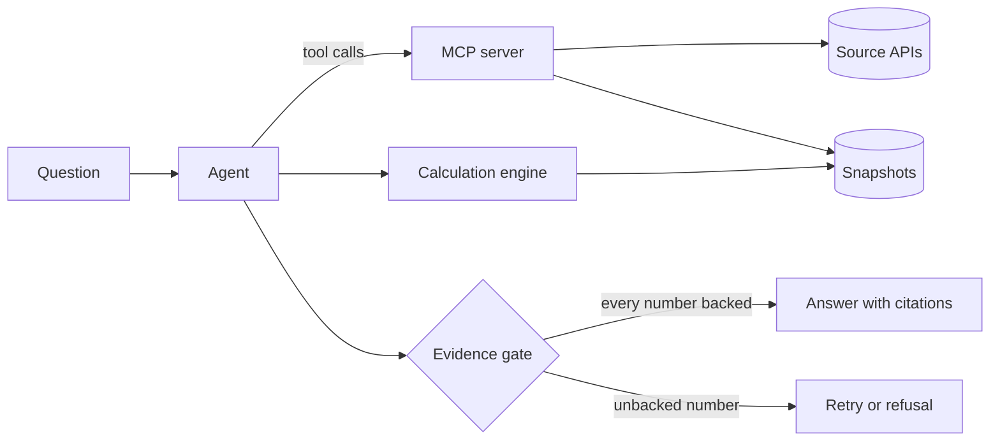

# Architecture

This page describes the target design. The status column shows what exists today.

## Components

| Component | Responsibility | Status |
| --- | --- | --- |
| MCP server | Table search, metadata and data from each source, with a provenance record on every data result | Specification in draft ([spec 0001](specs/0001-ssb-mcp-server.md)) |
| Calculation engine | Runs typed calculation plans as SQL in DuckDB over stored snapshots, with exact decimals | Planned, M2 |
| Evidence gate | Matches every number in an answer to source data or a calculation result, and blocks the answer otherwise | Planned, M2 |
| Agent | Plans, calls tools and drafts the answer, built with LangGraph | Planned, M2 |
| Evaluation suite | Versioned questions with computed answers, run with Inspect AI | Planned, M2 |
| Table search | Hybrid full-text and vector search over table metadata, in PostgreSQL with pgvector | Planned, M3 |
| Model gateway | Routes requests between local and hosted models within budgets, using LiteLLM | Planned, M3 |
| Tracing | OpenTelemetry traces, viewed in Langfuse | Planned, M3 |

## Provenance

Every value that leaves the MCP server carries a record of where it came from: the
source, the licence, the table, the API request, the retrieval time and a SHA-256
hash of the raw response. The evidence gate and the user interface both build on
this record. [Spec 0001](specs/0001-ssb-mcp-server.md) defines it.

## Trust boundaries

- Tools only read. The agent handles untrusted text, such as the question and text
  inside source data, without access to secrets and without any way to change
  things outside its own run. This follows Meta's
  [Rule of Two](https://ai.meta.com/blog/practical-ai-agent-security/) for agents.
- The language model never states a number from its own knowledge. Numbers come
  from tools and from the calculation engine ([ADR 0004](adr/0004-evidence-gate.md)).

## Decisions

The reasons behind these choices are in the [decision records](adr/README.md).
