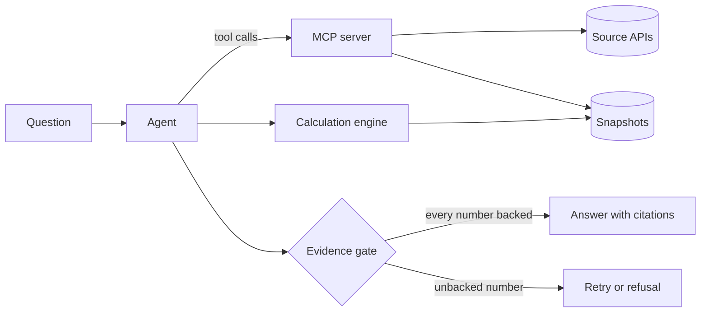

# Architecture

This page describes the target design. The status column shows what exists today,
and everything else on the page is planned. The reasons behind the choices are in the
[decision records](adr/README.md).

## Components

| Component | Responsibility | Status |
| --- | --- | --- |
| MCP server | Table search, metadata and data from each source, with a provenance record on every data result | In progress ([spec 0001](specs/0001-ssb-mcp-server.md)) |
| Calculation engine | Runs typed calculation plans over stored snapshots: DuckDB selects the cells, and the arithmetic uses exact rational numbers | Built; the `calculate` tool comes with the agent ([spec 0002](specs/0002-snapshots-and-calculation.md)) |
| Evidence gate | Matches every number in an answer to source data or a calculation result, and blocks the answer otherwise | Built; the agent's retry comes with the agent ([spec 0003](specs/0003-evidence-gate.md)) |
| Agent | Plans, calls tools and drafts the answer, in a loop of its own over a chat completions API | Built; not yet measured with a model ([spec 0004](specs/0004-agent.md)) |
| Evaluation suite | Versioned questions with computed answers, run with Inspect AI | Specification approved ([spec 0005](specs/0005-evaluation-suite.md)) |
| Table search | Hybrid full-text and vector search over table metadata, in PostgreSQL with pgvector | Planned, M3 |
| Model gateway | Routes requests between local and hosted models within budgets, using LiteLLM | Planned, M3 |
| Tracing | OpenTelemetry traces, viewed in Langfuse | Planned, M3 |

## Package layout

One Python package, `opencited`, with one subpackage per layer. A module imports only
from the modules above it in the table, so the source clients and the snapshots
stay free of the server, the agent and the evaluations. `ProvenanceRecord` lives in
`opencited.provenance` and `QueryResult` in `opencited.sources`. The Inspect task
lives outside the package, in `evals/`.

| Module | Contents | Milestone |
| --- | --- | --- |
| `opencited.values` | Decimal parsing, the decimal type that JSON writes in fixed point and never reads from a float (M1), and formatting in Norwegian and English (M2) | M1 |
| `opencited.model` | The strict, frozen base of every model, and the field types they share | M1 |
| `opencited.http` | The HTTP client, the rate limiter and the response cache | M1 |
| `opencited.provenance` | The provenance record, built from the exchange that a result came from | M1 |
| `opencited.sources` | The interface every source implements, and the registry of sources | M1 |
| `opencited.sources.pxweb` | PxWebApi 2 selections: codes and expressions expanded on the metadata, and cell counts | M1 |
| `opencited.sources.ssb` | The StatBank client: search, metadata, data, queries with provenance, and JSON-stat parsing | M1 |
| `opencited.snapshots` | Write-once snapshots of query results: the raw body, the provenance record, labels and units, and the cells in Parquet | M2 |
| `opencited.mcp` | The MCP server and its three tools | M1 |
| `opencited.cli` | The command line: `opencited mcp` (M1) and `opencited ask` (M2) | M1 |
| `opencited.calc` | Typed calculation plans, the SQL they generate and exact rational arithmetic | M2 |
| `opencited.gate` | Number extraction from answer text and matching against values and results | M2 |
| `opencited.agent` | The loop that calls the model and the tools, checks answers and retries | M2 |
| `opencited.evals` | The deterministic scorer and the runner for reference plans | M2 |

## Source layer and MCP server (M1)

### Requests

A tool call becomes at most two requests to the source API: a metadata request,
usually served from the cache, and a data request.

1. The tool validates its input against the schema the server publishes. A table ID
   must have five digits. A malformed input fails before any request is sent.
2. For `query_table`, the client reads the table metadata, expands the selection to
   the value codes it covers and counts the cells. A selection above the limit fails
   before the data request.
3. The client sends the data request as GET when the URL fits within a conservative
   length, and as POST otherwise ([ADR 0007](adr/0007-ssb-pxwebapi-v2.md)).
4. The raw response body is kept as bytes. Its SHA-256 is computed from those bytes,
   and the values are parsed from the same bytes.
5. The result carries the values, the symbols and notes for missing values, and one
   provenance record.

### Data model

| Type | Fields |
| --- | --- |
| `TableSummary` | ID, title, first and last period, last update, link |
| `TableMetadata` | ID, title, units, dimensions with codes and labels, notes, last update, link |
| `Dimension` | Code, label, values in source order, whether it is the time dimension, whether it may be left out |
| `Observation` | One value code per dimension, the value as a decimal or none, and the symbol when the value is missing |
| `QueryResult` | Table ID, dimension order, observations, notes, symbol explanations, provenance, and whether it came from the cache |
| `ProvenanceRecord` | The fields in spec 0001: source, publisher, licence, table, request, retrieval time and response hash |

Values are `Decimal` inside the package and decimal strings at the MCP boundary
([ADR 0009](adr/0009-exact-decimals.md)). Every type is a frozen Pydantic model in
strict mode, so the output schema of each tool comes from the same model that the
code uses.

### Errors

| Situation | Error | Seen by the client as |
| --- | --- | --- |
| Invalid table ID, unknown dimension or value code | Validation error with the allowed values | Tool error, so the model can correct the call |
| Selection above the cell limit | Error with the cell count and how to narrow the selection | Tool error |
| Source unavailable, timeout or HTTP 5xx | Error that names the source and says nothing was returned | Tool error |
| Rate limit reached | The client waits up to 10 seconds for a free slot, then reports when the next one is free | Tool error |
| Data requested from 05:00 to 08:15 Norwegian time | Error that names SSB's revision period | Tool error |
| An answer from SSB that breaks the expected form | Error that names the value that does not fit | Tool error |
| Any other failure inside the server | Logged on the server, without its text sent on | Tool error with no detail |
| Malformed protocol request | Handled by the MCP SDK | Protocol error |

### Caching and rate limits

Metadata and data responses are cached in SQLite, keyed by the method, the URL and a
hash of the body ([ADR 0008](adr/0008-http-client.md)). An entry stores the response
as it arrived, with its retrieval time, so a cached result repeats the original
provenance, and a query result says whether its data came from the cache. A response
is stored only once the result built from it has been accepted, so an answer that
cannot be parsed, or a reply with other cells than the selection, is never served
again. An entry is served until the first 08:15 Norwegian time after its request,
when the figures published at 08:00 are final. A data response requested or received
from 05:00 to 08:15 is not stored, and search results and `/config` are not cached.
When SSB cannot be reached, a call fails with an error and never falls back to an
expired entry.

`opencited mcp` keeps the cache in `responses.sqlite` in the user's cache directory,
which `platformdirs` finds for each system, for example `~/.cache/opencited` on
Linux. `--cache-dir` moves it and `--no-cache` turns it off. The bodies can name the
staff behind a table, so on systems with POSIX permissions the file is readable by
its owner only, and so is a directory that the cache creates. A cache that cannot be
read or written is skipped with a warning.

Every request to SSB waits for a slot in a client-side rate limiter: at most 30 in
any 60 seconds, the limit in SSB's guide ([ADR 0007](adr/0007-ssb-pxwebapi-v2.md),
decision 3). The limiter also keeps the policy that a response's
`x-ratelimit-policy` header states, and a request goes out only when every policy
allows it, so a header can only make the limiter stricter. SSB's responses state 40
in 60 seconds. After HTTP 429 the limiter lets no request through for the seconds in
`Retry-After`, at most an hour, or for a whole window when the header is missing. A
tool call waits at most 10 seconds for slots in all, and a query, which sends a
metadata and a data request, checks the revision period again once its data request
has a slot. A cached response takes no slot. The limiter counts the requests of one
process, so two servers that share a cache each keep their own count.

### Transports

`opencited mcp` serves the tools over stdio. `opencited mcp --http` serves them over
Streamable HTTP at `/mcp` on `127.0.0.1`, port 8765 unless `--port` sets another.
`--host` accepts loopback addresses only. Over HTTP the server refuses a request
whose `Origin` header names a page that is not local with HTTP 403, as the
[MCP specification](https://modelcontextprotocol.io/specification/2026-07-28/basic/transports/streamable-http)
requires against DNS rebinding. The SDK also refuses a `Host` header that does not
name a loopback address, with HTTP 421. The server uses the official MCP Python SDK,
which answers clients of the 2026-07-28 revision and of earlier revisions
([ADR 0003](adr/0003-mcp-2026-07-28.md)).

The tools are listed in a fixed order: `search_tables`, `get_table_metadata` and
`query_table`. Each declares an input schema, an output schema generated from the
result models, and annotations that mark it as read-only. Invalid arguments and the
errors of the source come back as tool errors whose text gives the reason.

The server reads the versions that SSB's `/config` reports in the background and
logs them, so a slow answer does not hold up a client's handshake.

`opencited mcp --replay DIR` serves the responses recorded in a directory instead of
calling SSB. It exists for the end-to-end tests, and the server logs a warning when
it starts with it, since the results are not live data and each provenance record
then gives the time of the replay.

A query result can be large. A recorded query on a table with four dimensions takes
about 73 bytes per cell in the structured content, and the SDK sends the result again
as indented JSON text, at about 130 bytes per cell, for clients that read only text.
At the limit of 5,000 cells that comes to about 1 MB.

### Testing

| Level | What it checks | Network |
| --- | --- | --- |
| Unit and property tests | Validation, selection expansion, cell counting, value parsing and formatting | None |
| Contract tests | Every client method against responses recorded from the live API | None, recorded fixtures |
| End-to-end tests | Every tool through an MCP client, over stdio and over HTTP, and in memory for quick tests | Local only |
| Live smoke test | Every tool through `opencited mcp` over stdio, against the real API, checking the form of each result and the table's dimensions against the recording | The source API |
| Model endpoint test | That the configured endpoint takes the four tool schemas and reports the model and usage | The model endpoint |

Fixtures are recorded by a script that writes the request and the raw response, with
SSB's contact details removed, to a file named with the recording date. A test transport replays them, so no fixture is
written by hand.

The live tests are marked `live` and left out of the default run. The `Nightly`
workflow runs them with `pytest -m live` at 01:17 UTC, which is 02:17 or 03:17 in
Oslo, outside the times that scheduled jobs avoid
([ADR 0007](adr/0007-ssb-pxwebapi-v2.md), decision 6), and it can be started by hand.
From 05:00 to 08:15 Norwegian time the query test expects the error that names SSB's
revision period instead of data.

The model endpoint tests are marked `model` and run only with `pytest -m model`, since
each call needs a key and costs a little; without the `OPENCITED_MODEL_*` variables
they fail and name the one that is missing. No test runs the agent against a model
that gives scripted answers ([spec 0004](specs/0004-agent.md)).

## Provenance

Every value that leaves the MCP server carries a record of where it came from: the
source, the licence, the table, the API request, the retrieval time and a SHA-256
hash of the raw response. The evidence gate and the user interface both build on
this record. [Spec 0001](specs/0001-ssb-mcp-server.md) defines it.

## Calculation and the evidence gate (M2)

The agent never states a number that it did not receive from a tool. With a snapshot
directory set, the MCP server stores each data result as a snapshot that it never
changes. The agent writes a typed calculation plan over these snapshots: DuckDB
selects the cells, and all arithmetic uses exact rational numbers, because DuckDB
returns floating point for division and means of decimals and does not catch every
overflow
([ADR 0011](adr/0011-snapshots-and-exact-arithmetic.md)). Before an answer is
released, the gate reads every number in the text and matches it to a value in the
results that its block cites ([spec 0003](specs/0003-evidence-gate.md)). The
evaluation suite runs the agent through Inspect AI and scores its answers against
answers computed by the same engine ([spec 0005](specs/0005-evaluation-suite.md)).

### Snapshots

`opencited mcp --snapshot-dir DIR`, or the variable `OPENCITED_SNAPSHOT_DIR`, keeps a
snapshot of every `query_table` result, including results from the cache. No
directory is set by default. A snapshot is a directory named by the
`response_sha256` of the result, which holds:

| File | Contents |
| --- | --- |
| `response.json` | The raw response body, whose SHA-256 is the snapshot's ID |
| `snapshot.json` | The provenance record, the language, the labels of every code, the units from the table's metadata, the SHA-256 of that metadata response and of the Parquet file, and the scale of the values |
| `observations.parquet` | One text column per dimension code, `value_text` with the value as written, `value` as `DECIMAL(38, s)` at the largest scale among the values, `symbol` and `unit` |

DuckDB writes the Parquet file from the cells, which reach it as JSON strings and are
cast to the decimal type, and reads it back with each value as a Python `Decimal`. A
snapshot is written to a temporary directory, flushed to disk and renamed into place,
and the store never changes it: a later response with the same body finds it in
place, and the snapshot keeps the provenance of its first retrieval. Reading a
snapshot checks that its body hashes to its ID and that the Parquet file hashes to
the SHA-256 that the manifest records. A result with a value that does not fit
`DECIMAL(38, s)` gets no snapshot, and any failure to write one leaves the tool
result as it is, with a warning in the server's log. The server checks at start that
it can write to the snapshot directory, and stops if it cannot.

### Calculation engine

`opencited.calc` runs a plan of at most 20 steps over the snapshots in a store. A
step reads cells from a snapshot, named by its ID, or combines the results of earlier
steps, named by their step names:

| Operation | Reads | Gives |
| --- | --- | --- |
| `value` | One cell | Its value |
| `sum` | One or more codes per dimension | The exact sum |
| `mean` | One or more codes per dimension, and decimals | The mean, rounded |
| `add`, `subtract`, `multiply` | Two results | The exact result |
| `divide` | Two results, and decimals | The quotient, rounded |
| `change_percent` | An old and a new result, and decimals | (new - old) / old x 100, rounded |
| `share_percent` | A part and a total, and decimals | part / total x 100, rounded |
| `rank` | One code per dimension apart from the one ranked, an order and a count from 1 to 10 | The highest or lowest cells, with ties of the last one |

The engine checks the whole plan before it runs any step: unique names, inputs from
earlier steps that give a single value, snapshots that can be read, codes that exist,
a code for every dimension and at most 5,000 cells per step. It then loads the
snapshots into an in-memory DuckDB database, from private copies of the Parquet bytes
whose hashes it checked, turns off external access and locks the configuration, so the
SQL it generates, with every code bound as a parameter, can read only the loaded
tables. A result column of a floating-point type is an error.

DuckDB selects and ranks; all arithmetic runs on Python `Fraction` values made from
the cells' values as SSB wrote them. A step with decimals rounds once, with ties away
from zero, and later steps use the rounded value; every step that gives a value also
keeps its exact result as a fraction. A step fails, with an error that names it, when
it reads a missing value, divides by zero, gives a result that needs more than the 38
digits of DuckDB's widest decimal type, counting its integer digits and its decimals,
or mixes units in `sum`, `mean`, `rank`, `add` or `subtract`. Numbers in a result
are written in fixed point.

Each result has a unit kind that the evidence gate can match: an amount, with the
source's unit; per cent, for `change_percent`, `share_percent` and cells whose unit
name holds `prosent`, `per cent`, `percent` or `%`; percentage points, for the
difference of two per cent values and cells whose unit name holds `prosentpoeng` or
`percentage point`; or a ratio, for the quotient of two values with the same unit. `parse_plan` reads a plan
from JSON and refuses an object that repeats a key.
A result lists every step with its operation, inputs, SQL, bound codes, arithmetic
with the numbers filled in, exact and rounded result and unit, and names every
snapshot it read with the provenance record. `readable()` writes the steps as text.

### Reading numbers in answers

`opencited.gate.numbers` reads every number in an answer in Norwegian or English, for
the evidence gate ([spec 0003](specs/0003-evidence-gate.md)). It normalises the text
to Unicode NFC and finds, in this order, citation markers, dates, periods, the
numbers of ordered list items, the forms that block an answer, and other numbers, so
a later pass never reads a digit that an earlier one read. It uses no model and no
network, and positions are offsets in the normalised text.

A number is read with its value and decimals, `12,50` as `Decimal("12.50")`: in
Norwegian text with digits grouped in threes by a space, U+00A0, U+202F or U+2009 and
a decimal comma, and in English text with commas between groups and a decimal point.
A minus sign, `-` or U+2212, counts at the start of the text, after a space, after an
opening bracket and after Markdown markup such as `**` or `|`. A hyphen or an en dash
between two numbers marks a range, whose ends are read on their own and share a
percent or scale word after the range. A percent word or sign, a percentage point
word or a scale word goes with its number.

Dates are ISO dates and timestamps, `13.10.2026` and dates with the month in words.
Periods are SSB's codes such as `2023K1` and `2023M01` and quarters and months in
words, read as SSB writes them; English months count only with a capital. The parts
of a date or a period may be separated by any of the spaces that group digits. Years
and five-digit table IDs are read as numbers, since only the cited results say whether
a number is a period, an ID or a value.

The gate is a check, so a form that it cannot read with certainty blocks the answer
with a reason. That covers the blocking forms of spec 0003: exponent notation, digits
other than 0 to 9, separators that fit neither language, a point between digits in
Norwegian text, digits grouped by spaces in English text, `billion` in Norwegian
text, numbers in words with a percent or scale word, compounds and fractions included,
and words that multiply. Beyond the specification it covers a number joined to
letters, such as `CO2` or `5G`; a sign or a dash before a number where spec 0003 reads
no minus sign, such as `x-3` or `–3`; unit and scale words that the specification
does not list, such as `mill` without its point, `mrd`, `bn` or `trillion`, since
reading the number without them would change its size; a percent word after a scale
word; a time of day in a timestamp; and a number of more than 60 digits.

### Matching numbers to evidence

`opencited.gate.check` takes the answer, its language and the evidence of the run:
each source result, a query, metadata or a search, with an evidence ID such as `E1`,
and each calculation result with an ID such as `C1`. It splits the answer into blocks,
paragraphs, list items, table rows and headings, and matches every number of a block
against the results whose markers the block holds. Since a citation must never reach
a number outside its block, the split errs towards smaller blocks: a blank line, a
thematic break such as `---`, a code fence and a change of block quote depth end a
block, every line that holds a pipe is a table row of its own, and a marker inside an
HTML comment cites nothing.

A period passes when a cited query result selected it, a date when it is the last
update or the retrieval date of a cited result in UTC or in Norwegian time, a
five-digit table ID when it is the ID of a cited result, and a number from the title
of a cited result, or from the label of a value it selected, when it is written as
there and has no unit, percent or scale word. A four-digit number that a cited query
result selected as a period counts as a year. Citation markers are not findings, and
the numbers of an ordered list are ignored when they count up from 1; any other
number at the start of a line is read as a number.

Every other number is a value. It fails in a block that cites no result. It passes
when a cited result holds a value `v` that, divided by any scale word and rounded with
ties away from zero to the decimals written, equals the number; for a calculation, `v`
is the step's exact result, and the values of the cells it ranked count too. A number
with a percent word matches only per cent values, one with a percentage point word
only percentage point values, and any other number only values that are not per cent,
so the sign and the unit must both fit. A citation of an evidence ID that the run does
not have fails. The rule checks which value a number may be and leaves what the number
refers to to the evaluation suite, so `5.6 million in 2026` passes when any cited
value rounds to 5.6 million.

The report lists every number with its position, kind and value, and the evidence and
cell or step it matched, or the reason it failed; the answer passes when nothing
failed. `Report.text()` writes the failures for the agent to send back to the model.

`opencited.values.format_number` writes decimals for each language with their scale:
in Norwegian with no-break spaces between groups, a decimal comma and the minus sign
U+2212, and in English with commas, a decimal point and a hyphen-minus. It groups an
integer part of five digits or more, so years keep their usual form. Every decimal it
writes is read back with its value and decimals.

## Agent (M2)

The agent answers one question in a loop over a chat completions endpoint
([ADR 0010](adr/0010-agent-loop.md)). It has not yet run with a model in this
repository's tests: the tests marked `model` need an endpoint, and the evaluation
suite that will measure the agent is planned.

### Configuration

`opencited.agent.config` reads the configuration from environment variables, so a
change of endpoint, model or key needs no code change.

| Variable | Setting | Default |
| --- | --- | --- |
| `OPENCITED_MODEL_URL` | The base URL of the endpoint, http or https, with no user name, password, query or fragment | Required |
| `OPENCITED_MODEL` | The model name | Required |
| `OPENCITED_MODEL_KEY_VARIABLE` | The name of the variable that holds the API key | Required |
| `OPENCITED_TEMPERATURE`, `OPENCITED_SEED` | Model settings, recorded in every answer | Not sent |
| `OPENCITED_PRICE_INPUT`, `OPENCITED_PRICE_OUTPUT` | Prices per million input and output tokens, set together | None |
| `OPENCITED_MAX_MODEL_CALLS`, `OPENCITED_MAX_TOOL_CALLS`, `OPENCITED_MAX_TOKENS`, `OPENCITED_MAX_SECONDS` | The limits of one question | 12, 20, 100,000 and 300 |
| `OPENCITED_MAX_COST` | A cost limit in the currency of the prices, which needs prices | None |

The configuration holds the name of the key variable and never the key.

### Model client

`opencited.agent.model.ModelClient` sends a conversation and the tool schemas to the
endpoint through the `openai` SDK over an `httpx2` client, and returns the reply's
text, its tool calls, the model name that the endpoint reports and the usage it
reports. It reads the key when it is made, drops space around it, refuses a key
with spaces or control characters inside, and keeps it inside the SDK client. Its
representation and its logs hold no key. An error from the endpoint is reported by
its status and the message field of its body with the key taken out, or for HTTP 401
and 403 by the variable's name alone, and it is raised with no error chain, since the
SDK's exception holds the request with its key. A response that is not a chat
completion, such as a web page at a wrong base URL, is an error, and a usage without
both token counts counts as no usage.

The SDK retries nothing, so every request is one model call that the agent counts.
The SDK would read an organisation, a project and extra headers from `OPENAI_*`
variables and send them to any endpoint; the client sends no organisation or
project, and refuses to start while `OPENAI_CUSTOM_HEADERS` is set. The SDK sends its
version and the platform it runs on in `X-Stainless-*` headers, and the HTTP client
uses the proxy that `HTTPS_PROXY` or `HTTP_PROXY` names. Over `http://` the key
travels unencrypted, so plain HTTP suits an endpoint on the same machine or network.

### Tools

`opencited.agent.tools.Toolbox` gives the model the three tools of the MCP server,
called through the official MCP client, and `calculate`, and no other tool that a
server may list. It runs only calls to these four tools whose arguments are a JSON
object, name no argument outside the schema, hold no control character and match
the published schema; numbers in arguments are parsed as integers or decimals, never
as floats. Control characters are refused because a pattern's `$` in Python also
matches before a final line break, so `05810` followed by one would match the table
ID pattern. A call that does not match is not run, and the model gets the reason with
the path to the part that does not match. For a step of a plan, the reason is why
the step does not match the operation it names. A server result that does not fit
its model fails the call and is logged.

Every result gets an evidence ID: `E1`, `E2` and so on for source results, and `C1`,
`C2` and so on for calculations. A call that fails gets none. The toolbox keeps the
results with their IDs as the evidence that the gate takes. Results reach the model
as compact JSON with their evidence ID, and every value both as a decimal string and
formatted for the language of the answer.

`calculate` publishes the plan schema of spec 0002 with an evidence ID wherever a
step names a snapshot. Before the engine runs, the toolbox replaces each ID with the
snapshot ID of that query result, and the engine runs in a worker thread. A result
that is not from `query_table`, an ID the run does not have and a query result
without a snapshot are reported to the model by their evidence IDs, and so are the
engine's errors. A snapshot that cannot be read is reported without the store's
reason, which can name a local path.

### Loop

`opencited.agent.loop.ask` sends a fixed system prompt, the question and the four
tool schemas, runs the tool calls of each reply and returns their results, until the
model replies without a tool call. The gate checks that reply. A blocked reply goes
back to the model with the gate report, at most twice. The prompt has a version,
`opencited.agent.prompt.PROMPT_VERSION`, which every answer records; a test holds the
hash of the prompt texts for each version, so a change to the texts needs a new
version.

The decision after each step is `opencited.agent.run.decide`, a plain function of
the run state, the limits and the prices: call the model, run tools, check an
answer, retry, release, refuse or fail. The loop only carries the decisions out.
Each limit counts as reached at its value. The time, token and cost limits are
checked before every decision, so a run that reaches one stops even with an answer
in hand; the model call limit is checked before a call, and the tool call limit
before the tools of a reply run, all of them or none. Tokens come from the usage
that the endpoint reports, and the cost is computed exactly from the prices. A model
call or a tool call that runs past the time limit is cancelled.

The model refuses by starting its reply with the line `REFUSE: no data` or
`REFUSE: outside the sources`, since it gets no tool besides the four. The line
after it is kept as the model's explanation only when the gate passes it. A reply
without usage, a reply with neither text nor a tool call, and an endpoint that
fails stop the run with an error that holds the usage so far; these are faults of
the endpoint or the model, and spec 0004 lists no refusal for them.

### Answers and refusals

`opencited.agent.answer` holds an answer's text with its markers, the language, a
citation for each result its markers name, the calculations it cites with every
step and its SQL, the gate report, the model as configured and as the endpoint named
it, the settings and prices, the prompt version and the usage: model calls, tool
calls, tokens, seconds and cost. A citation of a query result holds its provenance
record and the cells whose values the answer uses, with their codes and labels, read
from the cells that the gate matched. A refusal holds its reason, the limit it
reached if any, the model's explanation if it passed the gate, the same records and,
after a blocked answer, the last gate report. No record holds the API key or the name
of its variable.

### `opencited ask`

`opencited ask "<question>"` builds the MCP server in the same process, with the
response cache and a snapshot store in the user's data directory unless
`--snapshot-dir` or `OPENCITED_SNAPSHOT_DIR` names another, and answers with the
configured model. The answer takes the language of the question: the language with
more of its common words in the question wins, each word with æ, ø or å counts as
Norwegian, and a tie goes to Norwegian; `--language` sets it instead. The command
prints the answer with its markers turned into numbered sources, and a refusal with
its reason, in the language of the answer. `--json` prints every record. It exits
with 0 for an answer, 3 for a refusal, 1 when the run fails and 2 when the
configuration, the key or the snapshot directory cannot be used.

## Trust boundaries

- Tools only read. The agent handles untrusted text, such as the question and text
  inside source data, without access to secrets and without any way to change
  things outside its own run. This follows Meta's
  [Rule of Two](https://ai.meta.com/blog/practical-ai-agent-security/) for agents.
- The language model never states a number from its own knowledge. Numbers come
  from tools and from the calculation engine ([ADR 0004](adr/0004-evidence-gate.md)).
- The HTTP transport binds to `127.0.0.1` by default and answers a request with an
  invalid `Origin` header with HTTP 403, as the
  [MCP specification](https://modelcontextprotocol.io/specification/2026-07-28/basic/transports/streamable-http)
  requires.
