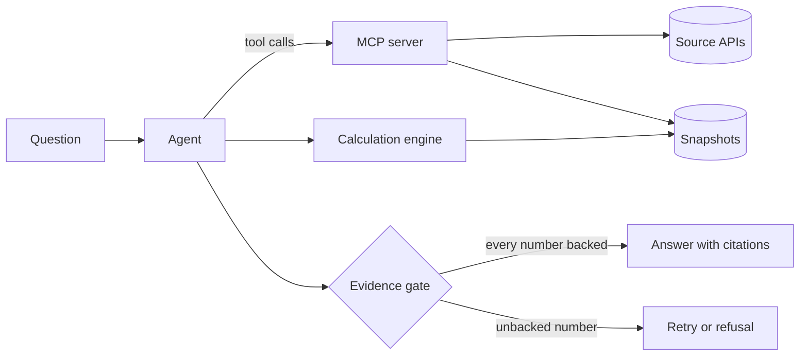

# Architecture

This page describes the target design. The status column shows what exists today,
and everything else on the page is planned. The reasons behind the choices are in the
[decision records](adr/README.md).

## Components

| Component | Responsibility | Status |
| --- | --- | --- |
| MCP server | Table search, metadata and data from each source, with a provenance record on every data result | Specification in draft ([spec 0001](specs/0001-ssb-mcp-server.md)) |
| Calculation engine | Runs typed calculation plans as SQL in DuckDB over stored snapshots, with exact decimals | Planned, M2 |
| Evidence gate | Matches every number in an answer to source data or a calculation result, and blocks the answer otherwise | Planned, M2 |
| Agent | Plans, calls tools and drafts the answer, built with LangGraph | Planned, M2 |
| Evaluation suite | Versioned questions with computed answers, run with Inspect AI | Planned, M2 |
| Table search | Hybrid full-text and vector search over table metadata, in PostgreSQL with pgvector | Planned, M3 |
| Model gateway | Routes requests between local and hosted models within budgets, using LiteLLM | Planned, M3 |
| Tracing | OpenTelemetry traces, viewed in Langfuse | Planned, M3 |

## Package layout

One Python package, `opencited`, with one subpackage per layer. A layer imports only
from the layers below it, so the MCP server, the agent and the evaluation suite can
share the source clients without depending on each other.

| Module | Contents | Milestone |
| --- | --- | --- |
| `opencited.values` | Decimal parsing and formatting, and the rule that values never become `float` | M1 |
| `opencited.provenance` | The provenance record, response hashing and retrieval times | M1 |
| `opencited.http` | The HTTP client, the rate limiter and the response cache | M1 |
| `opencited.sources` | The interface every source implements, and the registry of sources | M1 |
| `opencited.sources.ssb` | The StatBank client: search, metadata, data, selections and JSON-stat parsing | M1 |
| `opencited.mcp` | The MCP server, its three tools and the command line entry point | M1 |
| `opencited.snapshots` | Stored raw responses and the parsed values as DuckDB tables | M2 |
| `opencited.calc` | Typed calculation plans and their translation to SQL | M2 |
| `opencited.gate` | Number extraction from answer text and matching against values and results | M2 |
| `opencited.agent` | The LangGraph graph that plans, calls tools, drafts and retries | M2 |
| `opencited.evals` | Inspect AI tasks and the deterministic scorer | M2 |

## Source layer and MCP server (M1)

### Requests

A tool call becomes at most two requests to the source API: a metadata request,
usually served from the cache, and a data request.

1. The tool validates its input against the schema the server publishes. A table ID
   must have five digits. A malformed input fails before any request is sent.
2. For `query_table`, the client reads the table metadata, expands the selection to
   the value codes it covers and counts the cells. A selection above the limit fails
   before the data request.
3. The client sends the data request as GET when the URL fits within a conservative
   length, and as POST otherwise ([ADR 0007](adr/0007-ssb-pxwebapi-v2.md)).
4. The raw response body is kept as bytes. Its SHA-256 is computed from those bytes,
   and the values are parsed from the same bytes.
5. The result carries the values, the symbols and notes for missing values, and one
   provenance record.

### Data model

| Type | Fields |
| --- | --- |
| `TableSummary` | ID, title, first and last period, last update, link |
| `TableMetadata` | ID, title, units, dimensions with codes and labels, notes, last update, link |
| `Dimension` | Code, label, values in source order, whether it is the time dimension, whether it may be left out |
| `Observation` | One value code per dimension, the value as a decimal or none, and the symbol when the value is missing |
| `QueryResult` | Table ID, dimension order, observations, notes, symbol explanations, provenance, and whether it came from the cache |
| `ProvenanceRecord` | The fields in spec 0001: source, publisher, licence, table, request, retrieval time and response hash |

Values are `Decimal` inside the package and decimal strings at the MCP boundary
([ADR 0009](adr/0009-exact-decimals.md)). Every type is a frozen Pydantic model in
strict mode, so the output schema of each tool comes from the same model that the
code uses.

### Errors

| Situation | Error | Seen by the client as |
| --- | --- | --- |
| Invalid table ID, unknown dimension or value code | Validation error with the allowed values | Tool error, so the model can correct the call |
| Selection above the cell limit | Error with the cell count and how to narrow the selection | Tool error |
| Source unavailable, timeout or HTTP 5xx | Error that names the source and says nothing was returned | Tool error |
| Rate limit reached | The client waits within a budget, then reports the limit | Tool error |
| Malformed protocol request | Handled by the MCP SDK | Protocol error |

### Caching and rate limits

Responses are cached in SQLite, keyed by the method, the URL and a hash of the body.
An entry stores the raw bytes, the retrieval time and the hash, so a cached result
repeats the original provenance and says that it came from the cache. A request
waits for a slot in a client-side rate limiter before it is sent, and a response
with HTTP 429 makes the client back off ([ADR 0008](adr/0008-http-client.md)).

### Transports

`opencited mcp` serves the tools over stdio. An option serves them over Streamable
HTTP on `127.0.0.1`. The server uses the official MCP Python SDK, which answers
clients of the 2026-07-28 revision and of earlier revisions
([ADR 0003](adr/0003-mcp-2026-07-28.md)).

### Testing

| Level | What it checks | Network |
| --- | --- | --- |
| Unit and property tests | Validation, selection expansion, cell counting, value parsing and formatting | None |
| Contract tests | Every client method against responses recorded from the live API | None, recorded fixtures |
| End-to-end tests | Every tool through an MCP client, in memory, over stdio and over HTTP | Local only |
| Live smoke test | The same calls against the real API, every night | The source API |

Fixtures are recorded by a script that writes the request and the raw response to a
file named with the recording date. A test transport replays them, so no fixture is
written by hand.

## Provenance

Every value that leaves the MCP server carries a record of where it came from: the
source, the licence, the table, the API request, the retrieval time and a SHA-256
hash of the raw response. The evidence gate and the user interface both build on
this record. [Spec 0001](specs/0001-ssb-mcp-server.md) defines it.

## Calculation and the evidence gate (M2)

The agent never states a number that it did not receive from a tool. It writes a
typed calculation plan, the engine turns the plan into SQL over the stored
snapshots, and DuckDB runs it with exact decimals. Division and rounding are
explicit steps in the plan, because DuckDB returns floating point for division of
decimals. Before an answer is released, the gate reads every number in the text and
matches it to a provenance record or a calculation result
([ADR 0004](adr/0004-evidence-gate.md)). The evaluation suite scores answers with a
deterministic scorer that compares them with answers computed by the same engine.

## Trust boundaries

- Tools only read. The agent handles untrusted text, such as the question and text
  inside source data, without access to secrets and without any way to change
  things outside its own run. This follows Meta's
  [Rule of Two](https://ai.meta.com/blog/practical-ai-agent-security/) for agents.
- The language model never states a number from its own knowledge. Numbers come
  from tools and from the calculation engine ([ADR 0004](adr/0004-evidence-gate.md)).
- The HTTP transport binds to `127.0.0.1` by default and checks the `Origin` header,
  as the MCP specification requires.
